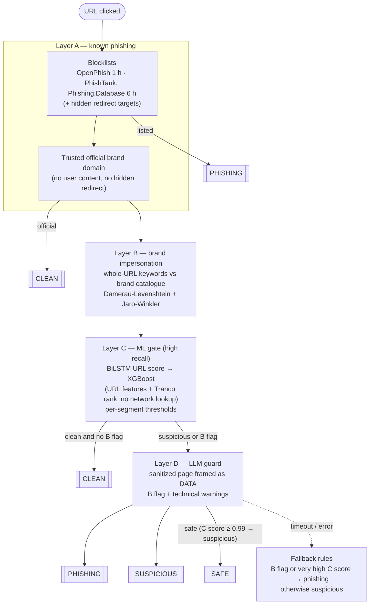

# Phishing URL detection with ML, deep learning and an LLM guard

[](https://github.com/Harry1211-web/Detect-URL-Phishing-with-LLM-pipline/actions/workflows/ci.yml)


[](LICENSE)

A four-layer system that decides, for a URL a user clicks, whether the website is **phishing**,
**suspicious** (warn the user) or **safe**. Cheap, exact checks run first; a **BiLSTM + XGBoost**
classifier clears most clean URLs in ~30 ms; an **LLM** reads the page only when the earlier
layers cannot clear it.

## Results at a glance

Every choice was made on validation / dev data; each held-out set was scored once per chosen
configuration. Full tables: [`reports/summary.md`](reports/summary.md).

| Held-out set | Phishing missed by layers A + B + C | Clean URLs cleared without the LLM |
|---|---|---|
| Dataset test (38,800 phishing / 42,425 clean) | **4 (0.010 %)** | 52.5 % |
| Vietnamese real-world set (2,681 / 1,584), no shared domain with training | **15 (0.56 %)** | 58.3 % |
| PhreshPhish external benchmark (9,991 / 10,003) | **43 (0.43 %)** | 44.5 % |

| Full pipeline on live Vietnamese pages (300 phishing + 300 clean) | Phishing warned | Warn F1 |
|---|---|---|
| Layer D = gpt-6-luna | 90.7 % | 0.904 |
| Layer D = claude-haiku-5-5 | 92.7 % | 0.911 |

- **Deep learning vs classic ML:** the best URL-only deep model (BiLSTM) misses 1.02 % of test
  phishing at the shared threshold; feeding its score into XGBoost with URL features and the
  Tranco rank brings that to **0.021 %**.
- **Prompt-injection defence:** on 100 real phishing pages × 6 hard injection attacks, the
  production sanitizer + nonce framing cut phishing → suspicious downgrades from 21 to 5 and
  phishing → safe flips from 1 to 0 (gpt-6-luna).

<!-- TODO: add a screenshot or GIF of the UI here, e.g.  -->

## Architecture




| Layer | Technique | Code |
|---|---|---|
| **A** Known phishing | Public feeds (also behind redirect parameters); official domains of verified brands end as clean | `src/blocklist/`, `src/pipeline.py` |
| **B** Brand impersonation | Keywords from domain, subdomains, path and redirect targets vs a brand catalogue; string-distance matching | `src/typosquatting/` |
| **C** ML gate | Deep URL model → gradient-boosted classifier, per-segment thresholds tuned for recall | `src/url_classifier/`, `src/layer_c_selection.py` |
| **D** LLM guard | Sanitized page content → phishing / suspicious / safe, explanation in the user's language | `src/llm/` |

## Machine learning (Layer C classifier)

- **Model:** XGBoost on the BiLSTM phishing score + hand-crafted URL features (length, structure,
  tokens, TLD, …) + the Tranco popularity rank of the domain, read from a local file.
- **Selection:** XGBoost, LightGBM and random forest compared on validation misses at a fixed rule
  (threshold that recognises ≥ 50 % of val clean URLs): XGBoost 19, LightGBM 19 (XGBoost kept for
  the higher val PR-AUC), random forest 31.
- **Ablation** (3 seeds, val misses): full model 18.0; without Tranco rank 392.7; without the
  BiLSTM score 29.3; without hand-crafted features 27.0.
- **Design trade-off:** DNS / TLS / RDAP host features gave only a small gain (3-seed ablation:
  17.0 vs 18.0 val misses; test misses 10 vs 12) but cost 1–2.5 s per new host, so production
  uses no network lookups (~30 ms p50). The rule "accept if val misses rise by at most 30 %" was
  fixed before training.
- **Thresholds per segment** (e.g. shared hosting platforms vs ordinary domains) keep almost every
  phishing URL away from "clean"; uncertain URLs go to Layer D rather than being blocked.
- **Classic baselines** under the same rule: logistic regression, random forest and LightGBM on
  lexical features miss 2.8–5.1 % of test phishing.

## Deep learning (URL models in PyTorch)

Five character-level architectures, trained with class-weighted BCE, AdamW and early stopping on
val ROC-AUC, then compared on validation misses at the same rule:

| Model | Val misses (selection) | Test miss rate | Test ROC-AUC | VN ROC-AUC |
|---|---|---|---|---|
| **BiLSTM** (embedding → BiLSTM → max + mean pool) | **414** | **1.02 %** | **0.9731** | **0.964** |
| CNN + BiLSTM (parallel convs 3/5/7 → BiLSTM) | 427 | — | — | — |
| char-CNN (convs 3/4/5 → global max pool) | 461 | 1.03 % | 0.9713 | 0.964 |
| URLNet, reduced (char CNN + hashed-word CNN) | 594 | 1.49 % | 0.9649 | 0.958 |
| Transformer encoder (2 layers, d = 64, 4 heads) | 1,095 | 2.77 % | 0.9472 | 0.825 |

- The chosen BiLSTM is **cross-fitted** (two models, each scoring the half it did not see), so
  XGBoost is trained on out-of-fold scores and does not learn from leaked, over-confident scores.
- Finding: URL-only deep models beat URL-only classic models on the test set but transfer badly to
  Vietnamese URLs (12–23 % misses at the val threshold). Combining the deep score with URL
  features and popularity in XGBoost fixes most of that (0.52 % VN misses).
- A DOM model (page structure) was also trained and measured; it may only add suspicion and is off
  in production because it did not meet the validation rule.

## LLM guard (Layer D)

- **Input:** page HTML sanitized (hidden text, same-colour text, comments, invisible characters,
  injected instructions removed), framed between random nonce markers as **data**, plus Layer B
  flags and technical warnings. Language-specific patterns live in
  `data/injection_patterns/<lang>.json` (16 languages); adding a language is adding a file.
- **Output:** a verdict keyword parsed strictly, plus an optional explanation in the user's
  language (default Vietnamese).
- **Model comparison** (same prompt, 2,004 test pages, 95 % Wilson intervals, paired McNemar):
  claude-haiku-5-5 misses fewer phishing pages (6.0 % vs 7.6 % → safe, p = 0.004) but blocks
  more clean pages (4.8 % vs 2.9 %, p = 0.005); gpt-6-luna costs ~$0.00013 per page vs $0.00022.
  gpt-6-luna is the default; run-to-run verdict agreement 96–97 %.
- **Fail closed:** an LLM "safe" on a URL the classifier is nearly sure of (score ≥ 0.99) becomes
  suspicious; timeouts and errors fall back to rules, never to "clean".
- **Red team:** six hard prompt-injection attacks (fake audit badge, official-domain notice, fake
  resolved ticket, multilingual claims, combined) on simulated and real pages — results above.

## Data and dates

Phishing URLs age fast (most sites live hours to days), so every set is dated. Rows of the
training set carry no per-URL date; the dates below come from the build and feed metadata.

| Set | Source | Collected / dated | Where the date is recorded |
|---|---|---|---|
| Training set `urls_labeled.csv` (534,908 URLs after the label audit) | PhishTank, Phishing.Database, OpenPhish feeds (pulled via their APIs / downloads); PhiUSIIL (UCI, 2024); crawl of Tranco-ranked sites | Built **2026-10-07** | `dataset/urls/stats.json` (`built_at`) |
| Label audit | Rules + hand review + VirusTotal checks | **2026-10-23** | git history, `dataset/urls/label_fixes.csv` |
| Layer A blocklist snapshot | OpenPhish, Phishing.Database (**2026-10-22**); PhishTank (**2026-10-13**, the 10-22 refresh failed) | 2026-10-13 – 2026-10-22 | `data/blocklist/meta.json` |
| Vietnamese test set (2,681 phishing / 1,584 clean) | ChongLuaDao blocklist snapshot of **2024-05-16**; `.vn` sites from Tranco; verified Vietnamese brand domains | Built **2026-10-13** | `listed_by` column, git history |
| PhreshPhish external test (19,994 URLs) | PhreshPhish (Hugging Face) | Pages dated **2025-09-08 – 2025-12-16** | `date` column |
| Live pages (300 + 300 Vietnamese, 400 top-site deep links) | Fetched live during the evaluation | **2026-10-23** | `time` field in `reports/live/*.json` |

Training data (Oct 2026 feeds) is newer than PhreshPhish (late 2025) and the ChongLuaDao snapshot
(May 2024), so the external sets test transfer to other sources, not to future phishing.

## Evaluation methodology

- **Splits by site**, so URLs of the same site never appear in both train and test.
- **Vietnamese test set** (ChongLuaDao phishing, crawled .vn clean pages) shares no registrable
  domain with any training or evaluation file.
- **Label audit** before the final runs: domains re-registered after collection dropped (2,703),
  popular homepages wrongly labelled phishing fixed (188), 234 candidates hand-reviewed. A
  300-page subset checked against VirusTotal shows 4.1 % label disagreement (95 % CI 1.9–8.6 %).
- **All results reported**, including models and changes that lost.

## Engineering

- **API** (`src/api.py`, FastAPI) behind a **backend-for-frontend** (`bff/app.py`): the browser
  never holds the API key; origin allowlist, per-IP rate limits, optional Cloudflare Turnstile,
  generic error messages; per-layer scores hidden by default (they would let an attacker tune a URL
  under the threshold).
- **Docker Compose:** api + bff + hourly blocklist updater, non-root containers.
- **LLM budget guard:** spend recorded per provider, calls stop at the budget set in `.env`.
- **Tests:** 141 pytest tests, run by GitHub Actions on every push; no paid API is called
  (13 skip without the downloaded blocklist / Tranco files).

## Quick start

1. **Environment** (Python 3.12):
   ```bash
   python -m venv .venv && source .venv/bin/activate    # Windows: .venv\Scripts\activate
   pip install -r requirements.txt
   # GPU training (optional): pip install torch==2.6.0 --index-url https://download.pytorch.org/whl/cu124
   ```
2. **API keys and budgets** — create `.env` in the project root (never commit it):
   ```ini
   OPENAI_API_KEY=...
   ANTHROPIC_API_KEY=...          # only for the Claude comparison
   VT_API_KEY=...                 # VirusTotal, only to verify labels (free key: 4 requests / minute, 500 / day)
   LLM_BUDGET_USD=7.70            # OpenAI spend limit
   ANTHROPIC_BUDGET_USD=4.8       # Anthropic spend limit
   ```
3. **Blocklists** (run hourly in production): `python src/blocklist/updater.py`
4. **Check a URL**:
   ```bash
   python src/pipeline.py "https://example.com/login"            # full pipeline
   python src/pipeline.py "https://example.com/login" --no-llm   # A + B + C only, no API cost
   python src/pipeline.py "https://example.com/login" --explain --lang vi
   ```
5. **Experiments** — `notebooks/pipeline_experiment.ipynb` runs everything end to end
   (`RUN_TRAINING = False` reuses the saved models; `True` re-runs selection and training, several
   GPU hours. `RUN_LLM = True` runs a paid step only when its report is missing).
   `notebooks/pipeline_demo.ipynb` runs the full pipeline on URLs set in its first cell.
6. **Tests**: `python -m pytest -q tests`
7. **HTTP service**:
   ```text
   Browser --HTTPS--> proxy --> bff (public, 127.0.0.1:8080) --private network--> api (X-API-Key)
   ```
   ```bash
   chown -R 1000 data                        # Linux: the containers run as uid 1000
   export API_KEY=$(openssl rand -hex 24)    # shared by bff and api only, never given to the UI
   export FE_ORIGINS=https://app.example.com # origin(s) of the UI
   docker compose up -d --build
   ```
   - BFF endpoints: `POST /api/analyze` `{"url": "...", "explain": false, "lang": "vi"}` →
     verdict, explanation, deciding layer; `POST /api/feedback` `{"url": "...", "label": "clean" |
     "phishing"}`; `GET /api/health`.
   - Settings: `BFF_RATE_PER_MIN` (10), `BFF_RATE_PER_DAY` (300), `TURNSTILE_SECRET`,
     `API_EXPOSE_LAYERS=1` to return per-layer scores, `USE_LLM=0` to turn off Layer D.
   - Local without Docker (two terminals):
     ```bash
     API_KEY=k123 uvicorn api:app --app-dir src --port 8000
     API_URL=http://127.0.0.1:8000 API_KEY=k123 FE_ORIGINS=http://localhost:5173 uvicorn app:app --app-dir bff --port 8080
     ```

## Repository structure

```
bff/                     Backend-for-frontend: public entry for the UI, adds the API key server-side
src/
  api.py                 HTTP API around the pipeline (private, called by the BFF)
  pipeline.py            Full A -> B -> C -> D decision for one URL (CLI)
  blocklist/             Layer A: feed updater, lookup
  typosquatting/         Layer B: brand impersonation, brand catalogue loader
  url_classifier/        Layer C: features, deep models, training, inference, DOM model
  llm/                   Layer D: client, sanitizer, evaluations, red teams, model comparison
  baselines/             Layer C baselines under the same rule
  data_collection/       Dataset builder, label audit, Vietnamese test-set builder
  layer_c_selection.py   DL then ML selection on validation data
  evaluate_*.py          Pipeline, external, live and shortcut evaluations
data/                    Language data, Vietnamese test set, blocklist snapshots
docs/                    Pipeline diagram (pipeline.svg)
dataset/                 Labelled URLs, brand catalogue, external (PhreshPhish) sets
models/url_classifier/   Production Layer C and DOM model
notebooks/               Full experiment notebook and a short demo
reports/                 JSON results of every experiment; summary.md has the tables
tests/                   pytest suite (no paid API calls)
```

`DIRECTORY_TREE.md` describes every file. `DATA_SOURCES.md` lists the data sources, their
licenses and citations.

## Limitations

- Only about half of clean URLs are cleared by layers A–C, so the LLM is called often; this is the
  price of a recall-first threshold.
- About half of the live Vietnamese phishing pages were already offline; their verdict comes from
  the fallback rules (suspicious), not from reading the page.
- 190 popular homepages could not be re-checked on VirusTotal (free quota) and keep their original
  phishing label.
- Baselines use one seed each; LLM results depend on provider model versions.

## License

Code: [MIT](LICENSE). Data from third parties keeps its own terms, see [DATA_SOURCES.md](DATA_SOURCES.md).
